# 🎓 CESI Suite — Modernisation ENT, Moodle & Scenari

> **Userscript Tampermonkey** complet conçu pour moderniser, fluidifier et sublimer l'environnement numérique de travail des étudiants du **CESI** (Portail ENT, Plateforme Moodle et Lecteurs de cours Scenari Topaze & Moodle Opale).

> 🤖 **Note sur la conception** : Ce projet a été développé et optimisé avec l'aide d'une **IA** (Google DeepMind / Antigravity).

---

## 🚀 Qu'est-ce que ça change ?

### 1. Tableau de bord ENT (`/accueil-apprenant`)
- **Design moderne et épuré** : Remplacement complet du thème Drupal natif par une interface élégante et aérée inspirée des standards web actuels.
- **Emploi du temps intelligent** : Affichage clair par jour, indication en temps réel des cours « En cours » et « Terminés », salles et intervenants bien mis en valeur.
- **Accès directs & Moodle** : Liens directs vers vos cours, Moodle, notes, carte étudiante et dossier de synthèse en 1 clic.
- **Mode Sombre / Mode Clair en 1 clic** : Bascule instantanée via le bouton Lune/Soleil dans la barre supérieure, avec mémorisation de votre préférence.

### 2. Sous-pages & Actualités ENT (`/actualites`, `/ressources-numeriques`, etc.)
- **Topbar unifiée** : Remplacement de l'ancien menu jaune encombrant par une barre de navigation fluide et identique à celle du tableau de bord.
- **Cartes d'actualités modernes** : Suppression des bordures et fonds blancs obsolètes pour un affichage net en cartes interactives.
- **Mode sombre intégral** : Aucun bloc blanc résiduel, typographie à fort contraste pensée pour le confort visuel.

### 3. Plateforme Moodle CESI (`moodle.cesi.fr`)
- **Harmonie visuelle** : Finies les barres d'onglets blanches aveuglantes et le texte noir illisible sur fond sombre.
- **Liste des cours sublimée** : Dans « Mes cours », les cartes et listes adoptent des cartes sombres stylisées avec barre de recherche intégrée.
- **Raccourcis rapides dans la barre Moodle** : Accès direct vers l'ENT CESI et vos cours sans encombrer la bannière principale.
- **Contournement des pages intermédiaires** : Lancement direct des activités LTI et ressources sans devoir cliquer plusieurs fois sur « Ouvrir dans une nouvelle fenêtre ».

### 4. Lecteur de cours Scenari & Opale (Topaze, AES, etc.)
- **Navigation latérale interactive** : Menus déroulants hiérarchisés avec indicateur visuel jaune sur le module actif.
- **Accès direct aux sous-pages** : Clic direct sur le module ouvrant la première leçon (contournement de la page d'accueil vide).
- **Cartes interactives modernes** : Présentation des sous-parties en grille de cartes au lieu des listes basiques.
- **Sommaire dynamique « Sur cette page »** et barre de progression de lecture intégrée.

### 5. Connexion SSO fluide
- Masquage des transitions d'authentification (WAYF et STS Viacesi) avec passage automatique pour éviter les pages blanches ou noires bloquantes.

---

## 📸 Comparatif Avant / Après

### 1. Tableau de bord ENT CESI (`/accueil-apprenant`)
| Avant (Site natif) | Après (Mode Clair) | Après (Mode Sombre) |
| :---: | :---: | :---: |
| 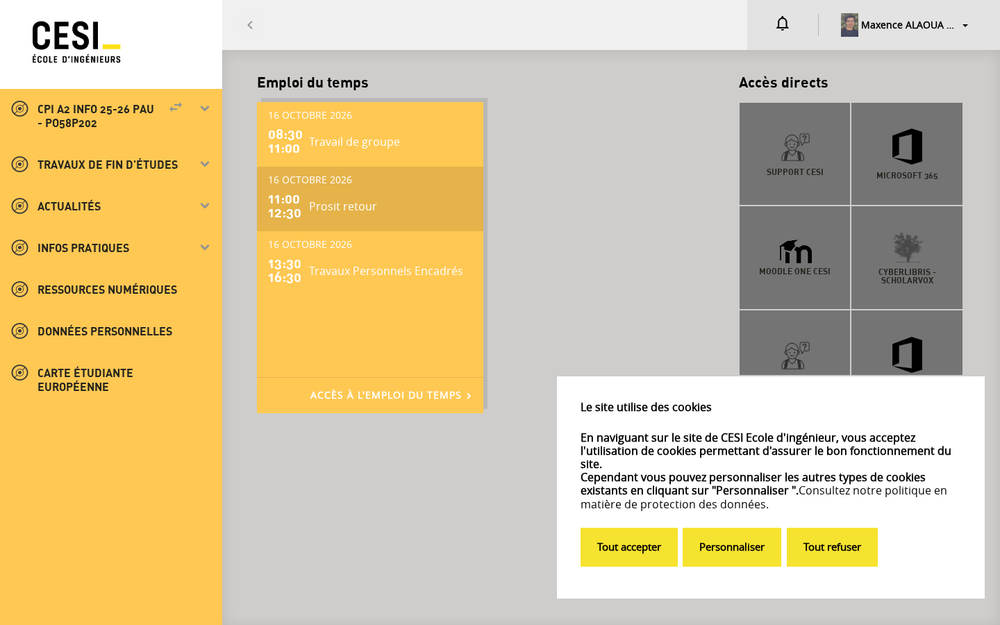 | 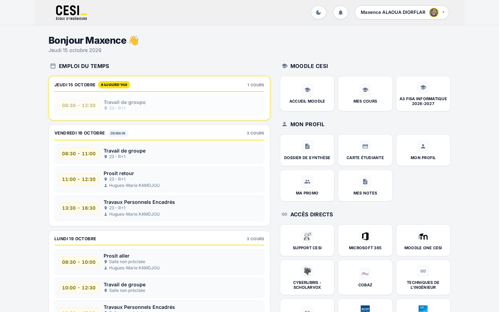 | 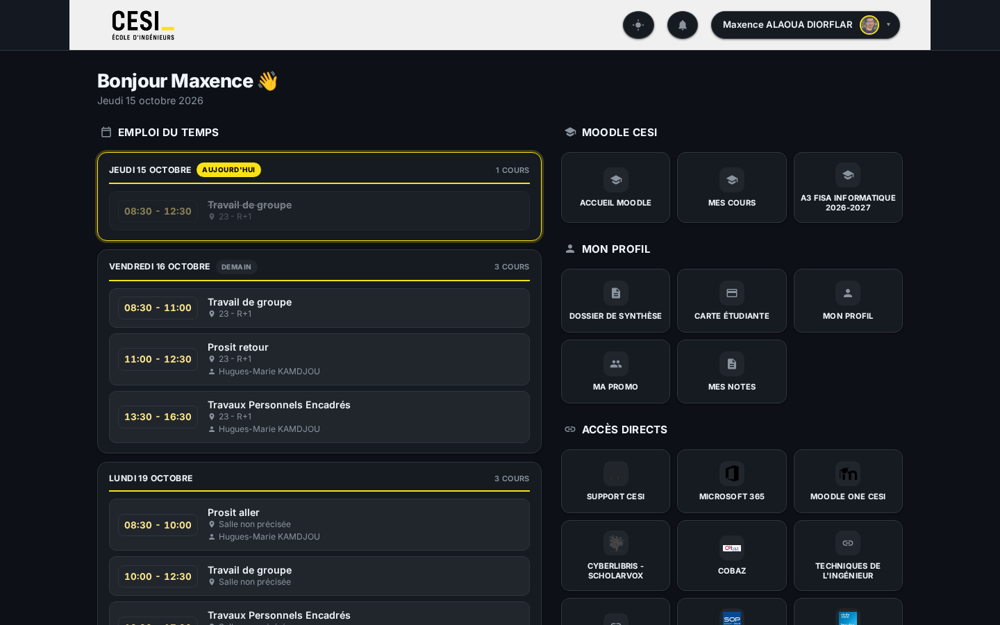 |

---

### 2. Sous-pages & Actualités ENT (`/actualites`)
| Avant (Site natif) | Après (Mode Clair) | Après (Mode Sombre) |
| :---: | :---: | :---: |
| 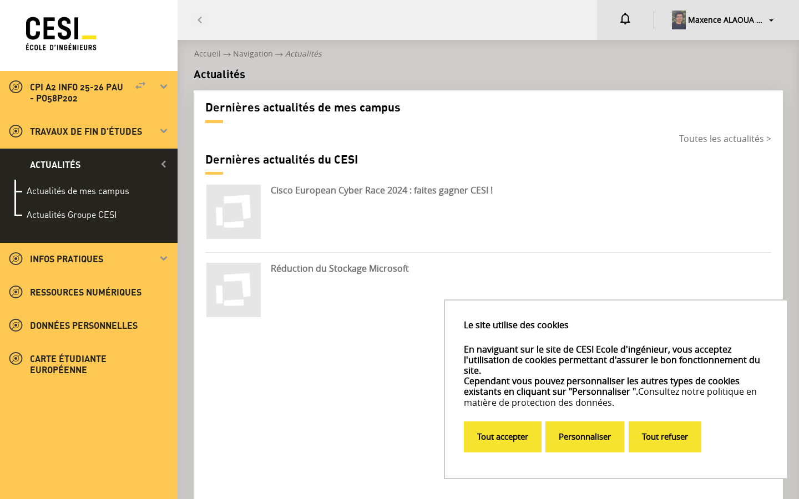 | 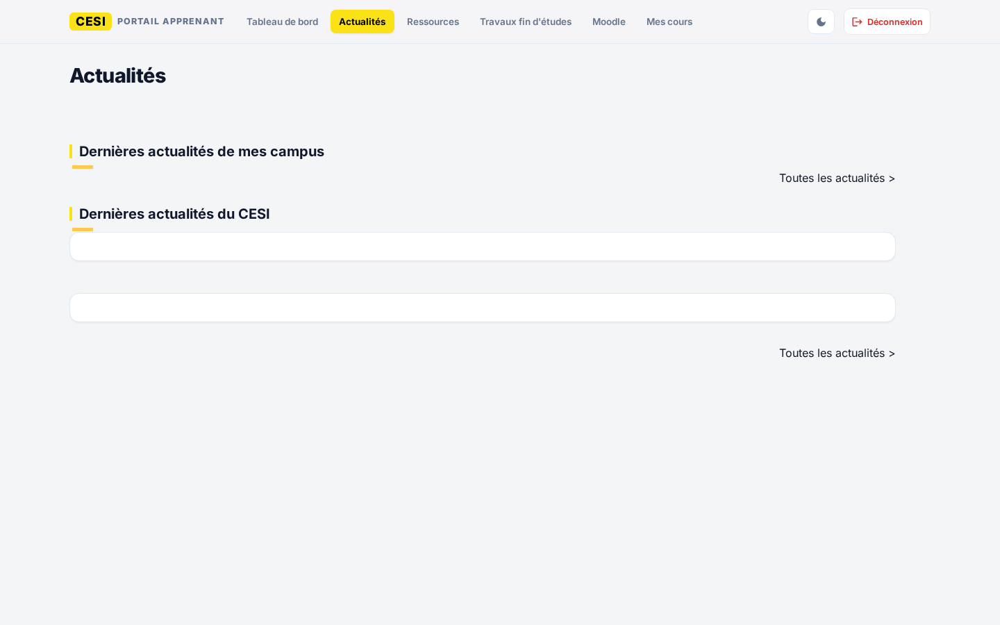 | 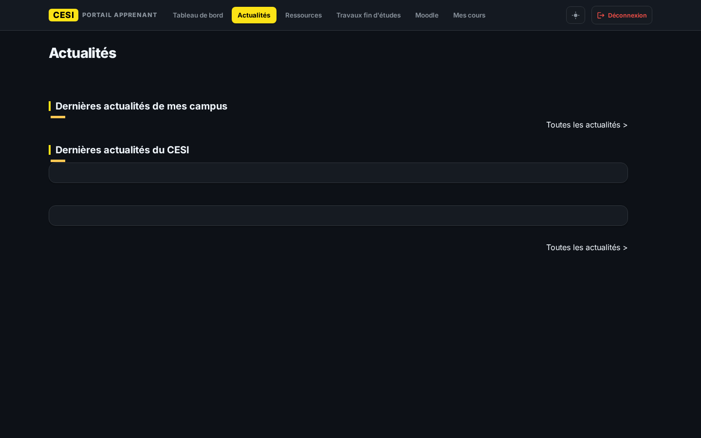 |

---

### 3. Page d'un Cours Moodle (`/course/view.php`)
| Avant (Site natif) | Après (Mode Clair) | Après (Mode Sombre) |
| :---: | :---: | :---: |
|  |  |  |

---

### 4. Vue « Mes cours » Moodle (`/my/courses.php`)
| Avant (Site natif) | Après (Mode Clair) | Après (Mode Sombre) |
| :---: | :---: | :---: |
| 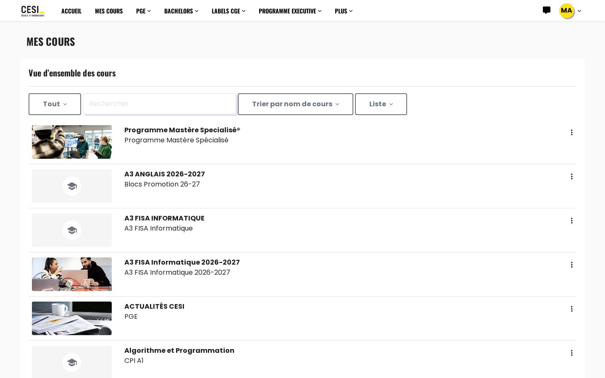 | 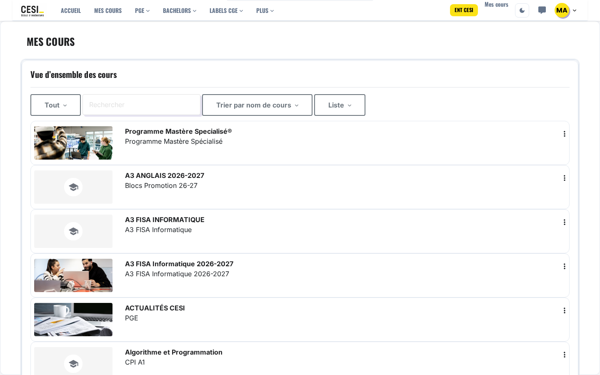 |  |

---

### 5. Lecteur de cours Scenari / Opale
| Avant (Lecteur natif) | Après (Mode Clair) | Après (Mode Sombre) |
| :---: | :---: | :---: |
| 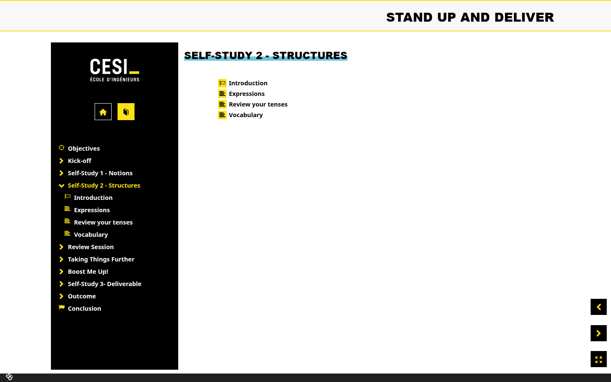 | 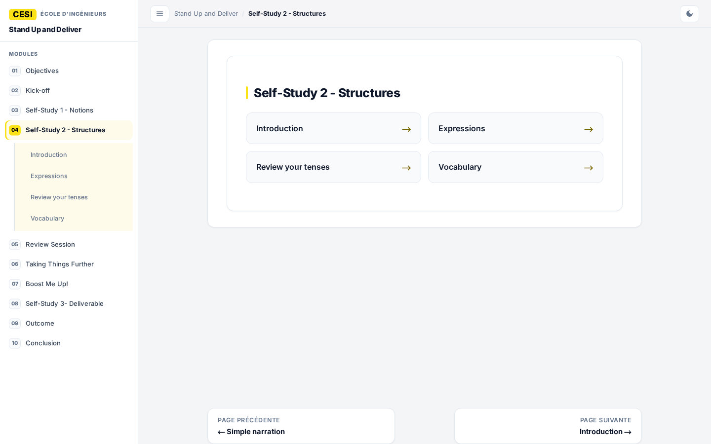 | 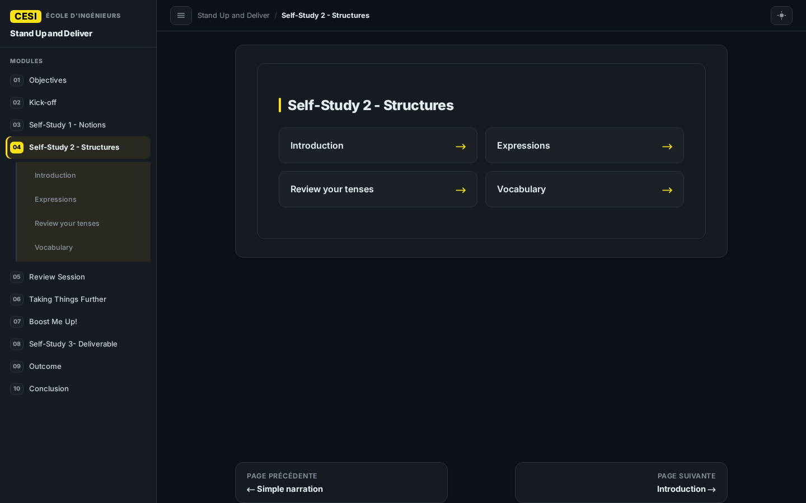 |

---

## 🛠️ Guide d'installation pas-à-pas

Ce guide s'adresse à tout apprenant ou étudiant CESI souhaitant installer l'extension en moins de 2 minutes.

### Étape 1 : Installer l'extension Tampermonkey
1. Rendez-vous sur le site officiel de Tampermonkey : [tampermonkey.net](https://www.tampermonkey.net/) (ou sur le store de votre navigateur : [Chrome Web Store](https://chromewebstore.google.com/detail/tampermonkey/dhdgffkkebhmkfjojejmpbldmpobfkfo), [Firefox Add-ons](https://addons.mozilla.org/fr/firefox/addon/tampermonkey/), Edge, etc.).
2. Cliquez sur **Ajouter à Chrome** (ou votre navigateur) puis confirmez l'installation.

---

### Étape 2 : Méthode rapide (Installation en 1 clic)
1. Cliquez directement sur ce lien d'installation :
   👉 **[Installer le script CESI Suite](https://raw.githubusercontent.com/TheGolden974/Tampermonkey-ENT-CESI/main/script.js)**
2. Tampermonkey va automatiquement ouvrir un onglet de prévisualisation :
   - Cliquez sur le bouton bleu **« Installer »** (ou « Mettre à jour »).
3. C'est tout ! L'extension est active et configurée pour se mettre à jour automatiquement dès qu'une nouvelle version sort.

---

### Étape 3 (Alternative) : Installation manuelle
Si vous préférez créer le script manuellement :
1. Cliquez sur l'icône **Tampermonkey** dans la barre d'outils de votre navigateur, puis sur **« Tableau de bord »**.
2. Cliquez sur l'onglet **« + »** (Ajouter un nouveau script).
3. Supprimez le modèle pré-rempli et collez l'intégralité du code disponible dans [`script.js`](https://raw.githubusercontent.com/TheGolden974/Tampermonkey-ENT-CESI/main/script.js).
4. Cliquez sur **Fichier** > **Enregistrer** (ou `Ctrl + S`).

---

### Étape 4 : Activer les mises à jour automatiques
Dans l'en-tête du script, les directives suivantes assurent les futures mises à jour en direct depuis GitHub :
```javascript
// @updateURL    https://raw.githubusercontent.com/TheGolden974/Tampermonkey-ENT-CESI/main/script.js
// @downloadURL  https://raw.githubusercontent.com/TheGolden974/Tampermonkey-ENT-CESI/main/script.js
```

Pour **forcer la mise à jour** la première fois ou vérifier les nouvelles versions :
1. Ouvrez le menu de l'extension Tampermonkey.
2. Cliquez sur **« Rechercher les mises à jour des scripts »** (ou dans le Tableau de bord > onglet *Utilitaires* > *Vérifier les mises à jour*).

---

### Étape 5 : Profiter du résultat !
Rendez-vous sur [ent.cesi.fr/accueil-apprenant](https://ent.cesi.fr/accueil-apprenant) ou sur [moodle.cesi.fr](https://moodle.cesi.fr/) pour découvrir votre nouvelle interface ! Vous pouvez basculer entre le mode clair et le mode sombre à tout moment via l'icône de lune/soleil en haut à droite.
